# Sezi nasıl çalışır?

Bu belge Sezi'nin parçalarını şemalarla anlatır: veri nereden gelir, rota nasıl bulunur, telefon yürürken ne yapar, ses nereden çalar. Kod ayrıntısı için [ARCHITECTURE.md](ARCHITECTURE.md).

---

## 1. Büyük resim

Sistem dört parçadan oluşur: **veri hattı**, **sunucu**, **admin paneli** ve **mobil uygulama**. Rota motoru ortak pakette (`packages/shared`) durur; hem telefon hem admin paneli aynı motoru kullanır.

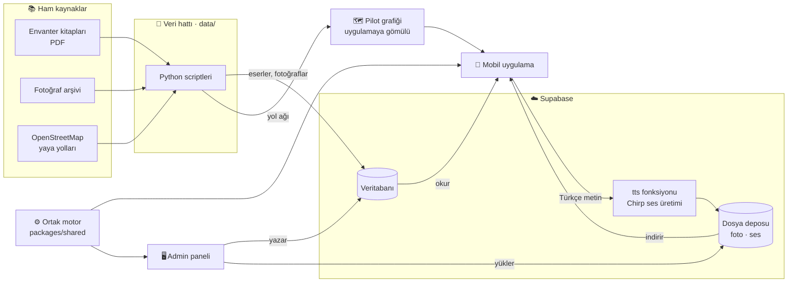

| Parça | Görevi | Bir cümleyle |
|---|---|---|
| Veri hattı | Kitaplardan ve haritadan veri çıkarır | "Ham bilgiyi düzenli tabloya çevirir" |
| Supabase | Veriyi, dosyaları ve izinleri tutar | "Ortak hafıza" |
| Admin paneli | İçerik girer, onaylar, rotayı dener | "Mutfak" |
| Ortak motor | Rota bulur, talimat kurar, yürüyüşü izler | "Beyin" |
| Mobil uygulama | Kullanıcıyı gezdirir | "Vitrin ve rehber" |

---

## 2. Veri hattı: kitaptan haritaya

Üç ayrı hat var. Hepsi `python -I data/<script>.py` ile çalışır, çıktısı ya veritabanına ya uygulamaya gider.

### 2a. Eser envanteri

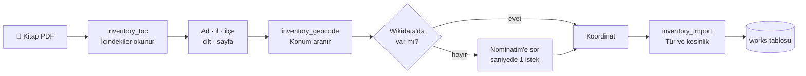

Konum ne kadar güvenilir? Uygulama bunu kullanıcıya açıkça gösterir:

| Kesinlik | Ne zaman | Haritada |
|---|---|---|
| 🎯 `exact` | Elle doğrulandı ya da güçlü Wikidata eşleşmesi | Nokta |
| 〰️ `approximate` | Zayıf eşleşme | "Yaklaşık" etiketi |
| ❔ `unknown` | Eşleşme yok | Haritada yok, listede var |

> **Telif kuralı:** Kitaptan yalnızca olgu alınır (ad, il, tür, cilt/sayfa). Metin ve fotoğraf kopyalanmaz.

### 2b. Fotoğraf eşleştirme

Arşivdeki dosya adları eseri söylemez ("ERD03201.jpg"). Hat, fotoğrafı kitaptaki görsellerle **görüntü parmak iziyle** karşılaştırır.

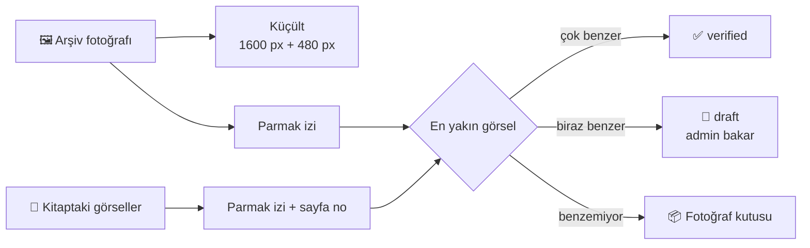

### 2c. Pilot yol grafiği

Bursa Hanlar Bölgesi'nin yaya yolları OpenStreetMap'ten indirilir, eserlerle birleştirilir ve **uygulamanın içine gömülür**. Bu sayede rota internetsiz hesaplanır.

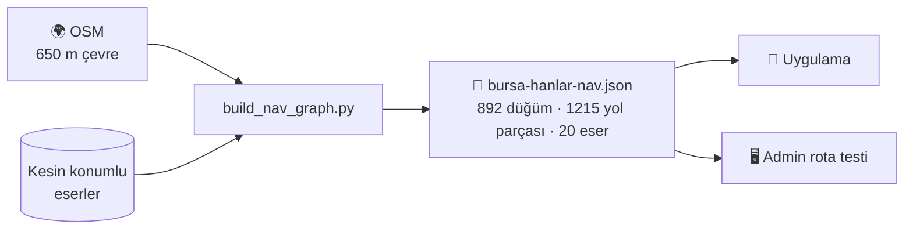

Her yol parçası (segment) şu bilgileri taşır:

| Bilgi | Örnek | Nereden |
|---|---|---|
| Uzunluk | 42 m | Geometri |
| Basamak | 3 | OSM `steps` |
| Eğim | %5 | OSM |
| Zemin | arnavut kaldırımı | OSM `surface` |
| Gürültü | 0–1 | Yol sınıfından tahmin |
| Yer işareti görünürlüğü | 0–1 | Yakındaki yer işaretleri |

---

## 3. Sunucu: kim neyi görür?

Supabase'deki her tablo bir **kapıdan** (RLS) geçer. Uygulama hiçbir zaman taslak içerik görmez.

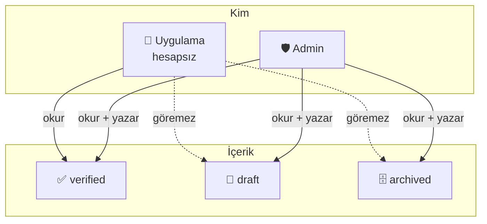

Uygulamanın okuduğu ana pencereler:

| Görünüm | İçinde ne var |
|---|---|
| `works_view` | Eser + il + tür + konum + kaynak + fotoğraflar + ses kaydı, tek satırda |
| `nav_points_view` | Başlangıç, yer işareti, anlatım ve varış noktaları |
| `segment_overrides` | Onaylanmış "bu yol kapalı / merdivenli" bildirimleri |

---

## 4. Admin → uygulama: içerik nasıl akar?

Kodda **sabit nokta ya da rota yoktur**. Rotayı değiştiren her şey admin panelinden veri olarak girilir.

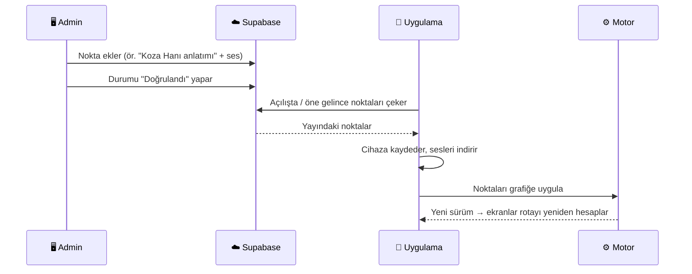

### Nokta rolleri

Bir yer birden çok rol taşıyabilir.

| Rol | Simge | Ne yapar |
|---|---|---|
| `start` | 🚩 | Başlangıç / buluşma yeri (durak, meydan) |
| `landmark` | 🗿 | Yer işareti: talimatta anılır ("Heykel hizasında sağa"), çevresindeki yolları "daha kolay bulunur" yapar |
| `story` | 💬 | Anlatım: yaklaşınca metin + ses açılır, rota buraya uğrar |
| `arrival` | 🏛️ | Esere varınca açılan bilgi |

### Erişilebilirlik bildirimi döngüsü

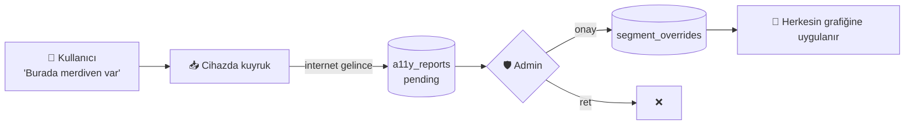

---

## 5. Rota motoru

Rota bulmak dört adımdır: **grafiği hazırla → her yola profile göre fiyat biç → en ucuz yolu bul → yol üstündeki noktalara uğrat.**

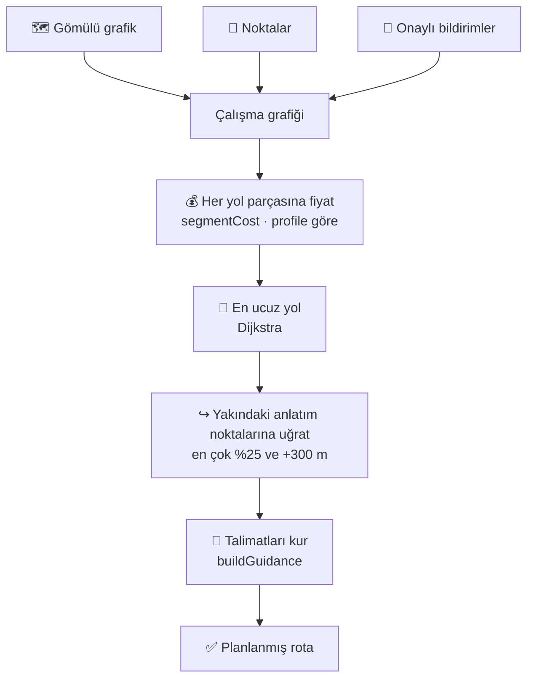

### Fiyat (maliyet) nasıl biçilir?

Başlangıç fiyatı **yolun metre cinsinden uzunluğudur**. Profil bu fiyatı artırır, azaltır ya da yolu tamamen kapatır.

| Durum | 🚶 Yürüyen | 🦯 Bastonlu | ♿ Tekerlekli sandalye | 👁️‍🗨️ Görme engelli |
|---|---|---|---|---|
| Basamak | + 2 m / basamak | + 15 m / basamak | ⛔ yol kapalı | yürüyenle aynı |
| Eğim > %8 | — | pahalılaşır | ⛔ yol kapalı | — |
| Dar yol < 90 cm | — | — | ⛔ yol kapalı | — |
| Arnavut kaldırımı | — | × 1,4 | × 1,8 | — |
| Gürültülü cadde | — | — | — | × 2'ye kadar |
| Kaldırım kenarı | — | — | ⛔ yol kapalı | × 1,3 |
| Yer işareti görünür | %30'a kadar ucuz | %30'a kadar ucuz | %30'a kadar ucuz | (görmediği için yok) |

> **Duymayan kullanıcı:** Rotası yürüyenle aynıdır. Fark rotada değil, **ipucunun türündedir** (bkz. §9).

### Üç tür plan

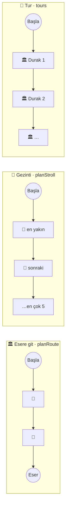

| Plan | Hedef | Sınır |
|---|---|---|
| Esere git | Seçilen eser | Uğrama en çok %25 ya da +300 m uzatır |
| Gezinti | Hedef yok, anlatım noktaları | 5 nokta, bacak ≤ 500 m, toplam ≤ 1,2 km |
| Tur | Aynı türden eserler sırayla | Her durak ayrı "esere git" |

---

## 6. Talimat motoru: cümle nasıl kurulur?

Kevin Lynch'in fikri: insanlar yolu **sokak adıyla değil, gördükleri şeylerle** bulur. Bu yüzden talimat önce bir yer işaretine dayanır.

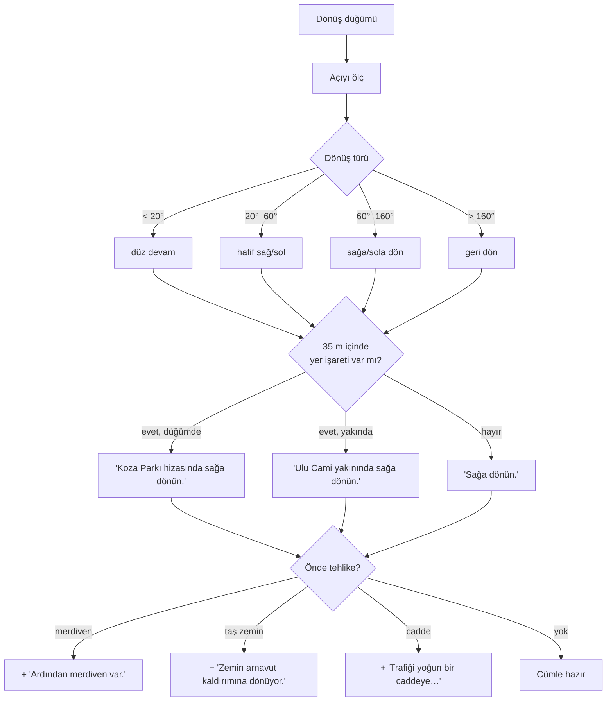

Ek kurallar:
- İki talimat arası **90 m'yi aşarsa** ortada teyit verilir: "Doğru yoldasınız; Okçu Baba Türbesi sağınızda."
- Tekerlekli sandalye rotasında merdiven zaten olmadığı için merdiven uyarısı verilmez.
- Rota sonunda: "Vardınız."

---

## 7. Navigasyon oturumu: yürürken ne olur?

Navigasyon ekranı üç aşamadan geçer.

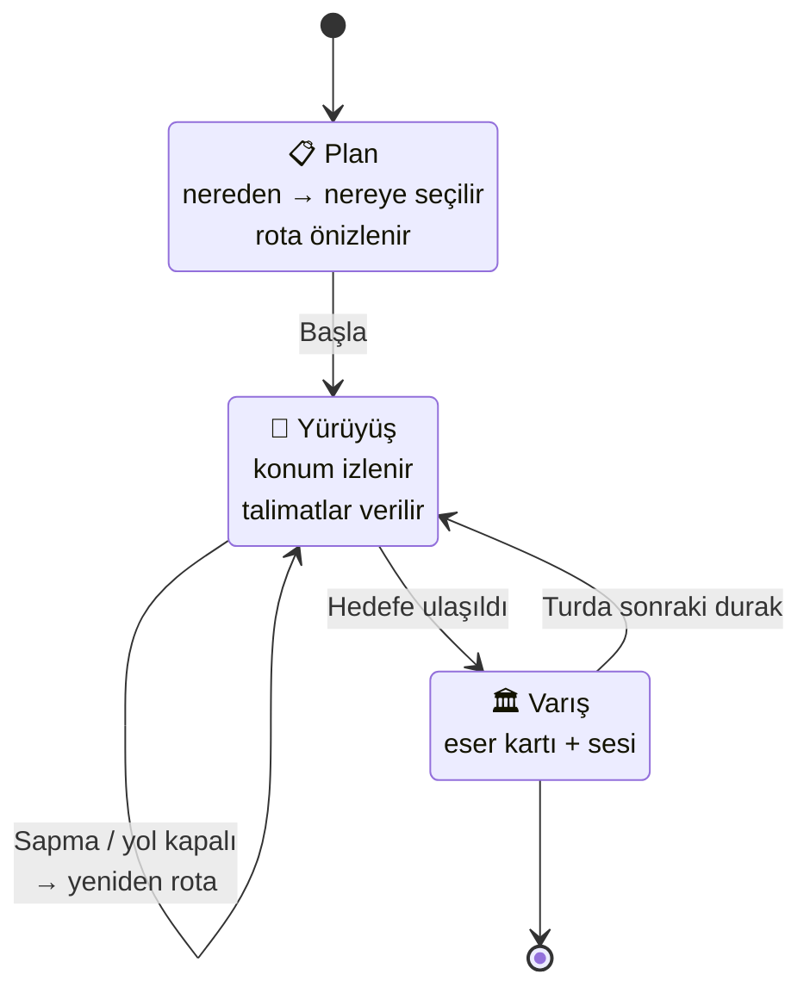

### Her konum ölçümünde

Telefon konumu iki kaynaktan alabilir. İkisi de **aynı takip adımından** geçer; bu yüzden simülasyonda görülen davranış gerçek yürüyüşte de aynıdır.

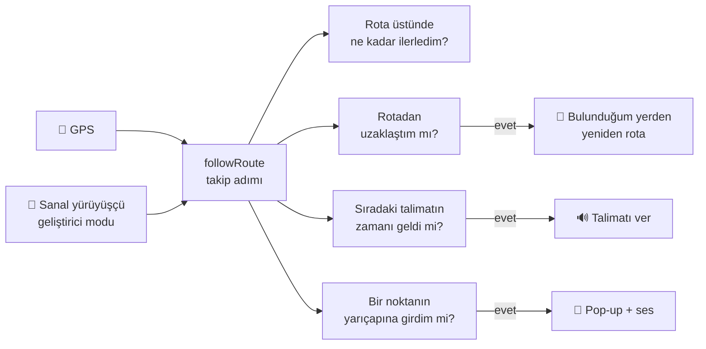

### Sapma kararı: tek sıçrama alarm değildir

GPS bazen bir anlığına 30 m sıçrar. Yanlış alarm olmasın diye:

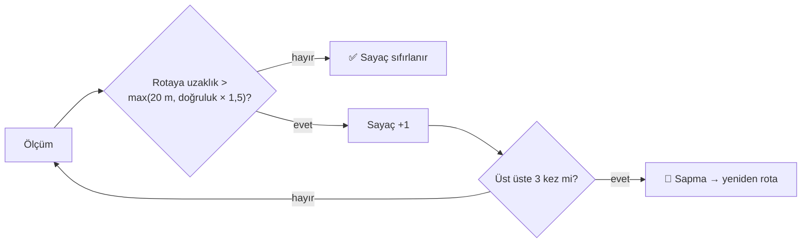

### Talimat zamanlaması

Talimat sabit metrede değil, **yürüme hızına göre dönüşten yaklaşık 4 saniye önce** verilir. Hızlı yürüyene daha erken, yavaş yürüyene daha geç söylenir.

### Nokta pop-up'ı

- Anlatım ya da varış noktasının yarıçapına girilince **bir yürüyüşte bir kez** açılır.
- Konum doğruluğu **50 m'den kötüyse** açılmaz (sıçrayan GPS yanlış pop-up açmasın).
- Kayıt çalarken talimatlar bekler, kayıt bitince okunur.

---

## 8. Ses motoru: hangi ses çalar?

Her konuşma isteği şu karar ağacından geçer:

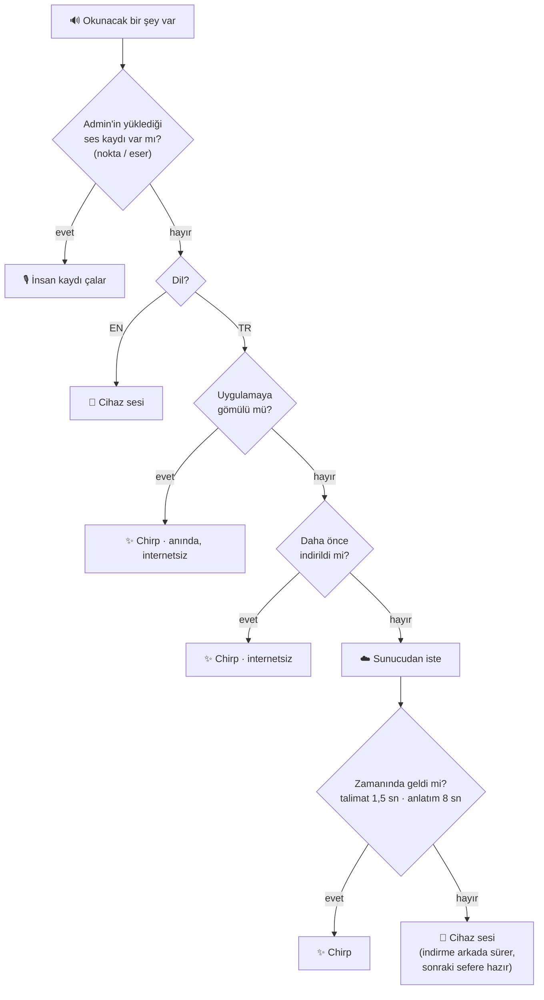

### Chirp sesi nasıl üretilir ve saklanır?

Aynı cümle **dünyada bir kez** üretilir. Sonra hem sunucuda hem telefonda saklanır.

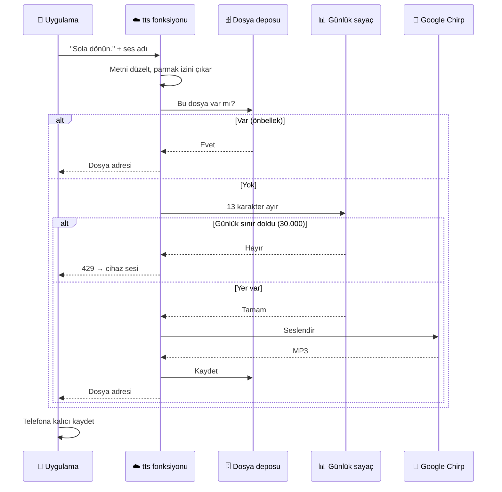

### Üç katmanlı önbellek

| Katman | İçinde | İnternet gerekir mi? | Ne zaman dolar |
|---|---|---|---|
| 📦 Uygulamaya gömülü | 28 sabit cümle ("Sola dönün.", "Vardınız."…) | Hayır | Uygulama paketlenirken |
| 💾 Telefon | Bir kez çalınmış / önceden indirilmiş cümleler | Hayır | Rota hesaplanınca, noktalar gelince |
| ☁️ Sunucu | Herkesin ürettiği tüm cümleler | Evet | İlk istendiğinde |

> Rota hesaplandığı anda o rotanın bütün talimatları arka planda indirilir. Kullanıcı yürümeye başladığında sesler genellikle telefondadır.

### Konuşma sırası

- Yeni talimat, okunmakta olanı **kesmez**; bitmesini bekler.
- Beklerken daha yenisi gelirse eskisi atılır (artık geçersizdir).
- Acil mesajlar (yol kapalı, rota değişti) **hemen** okunur, öncekini keser.

---

## 9. Ses manzarası (soundscape)

Görme engelli kullanıcı yer işaretlerini **sesinden** tanır: çeşmeden su sesi, handan çarşı uğultusu, diğer yapılardan yumuşak bir ton gelir. Sesler şimdilik sentezlenir; saha kayıtları gelince değişecek.

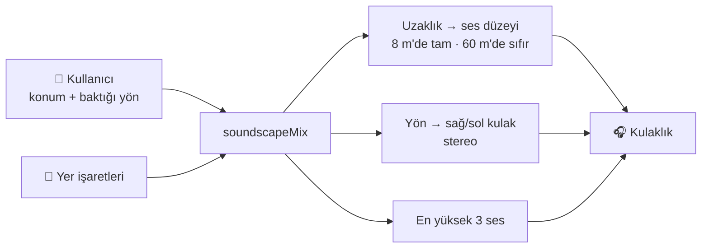

| Eser türü | Ortam sesi |
|---|---|
| Çeşme, sebil, hamam, sarnıç | 💧 su |
| Han, çarşı, kervansaray | 🛍️ çarşı |
| Diğerleri (cami dahil; ezan gibi dinî ses kullanılmaz) | 🔔 ton |

---

## 10. Profile göre ipucu

Kurala göre **her ses ipucunun görsel ve dokunsal bir karşılığı vardır.** Profil hangisinin öne çıkacağını seçer.

| Profil | 🔊 Ses | 👀 Görsel | 📳 Titreşim |
|---|---|---|---|
| Yürüyen | ✅ talimat | ✅ harita + kart | ✅ |
| Görme engelli | ✅ talimat + ses manzarası | — | ✅ |
| Az gören | ✅ | ✅ tek renkli, yüksek kontrast | ✅ |
| Duymayan | ❌ | ✅ ekran kenarı parlar (`CueFlash`) | ✅ |
| Gürültülü ortam (elle açılır) | ❌ geçici | ✅ parlama | ✅ |

---

## 11. İnternet olmadan ne çalışır?

| Özellik | İnternetsiz | Neden |
|---|---|---|
| Rota hesabı | ✅ | Grafik uygulamanın içinde |
| Noktalar (başlangıç, anlatım…) | ✅ son bilinen hâl | Cihazda saklanır |
| Nokta ses kayıtları | ✅ indirildiyse | Önceden indirilir |
| Sabit Türkçe talimatlar | ✅ | Uygulamaya gömülü |
| Rotanın diğer talimatları | ✅ rota internetliyken hesaplandıysa | Önceden indirilir |
| Yeni bir Türkçe cümle | ⚠️ cihaz sesiyle | Sunucuya ulaşılamaz |
| Eser listesi, fotoğraflar | ❌ | Henüz çevrimdışı önbellek yok |

---

## 12. Admin rota testi: telefonsuz deneme

Admin panelindeki **Rota testi**, telefondaki motorun **aynısını** tarayıcıda çalıştırır. Rota davranışı değişince önce burada bakılır.

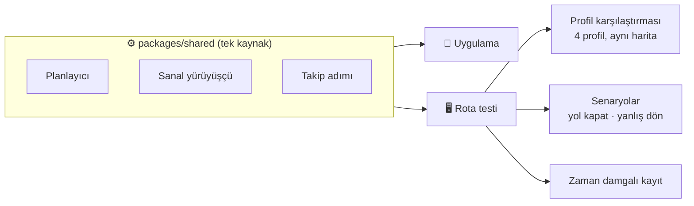

---

## Sözlük

| Terim | Anlamı |
|---|---|
| **Düğüm (node)** | Yolların kesiştiği nokta |
| **Segment** | İki düğüm arasındaki yol parçası |
| **Yer işareti (landmark)** | Akılda kalan, görünen yapı: heykel, çeşme, cami |
| **Maliyet** | Bir yolun profile göre "zahmeti"; motor en az zahmetli yolu seçer |
| **Dijkstra** | En ucuz yolu bulan klasik algoritma |
| **Uğrama (via)** | Rotanın hedefe giderken bir anlatım noktasından geçmesi |
| **Sapma** | Kullanıcının rotadan uzaklaşması |
| **Chirp 3 HD** | Google'ın doğal Türkçe sentetik sesi (Laomedeia) |
| **RLS** | Veritabanında "kim hangi satırı görür" kuralı |
| **verified / draft** | Yayında / taslak |
| **Edge function** | Sunucuda çalışan küçük fonksiyon (`tts`) |
