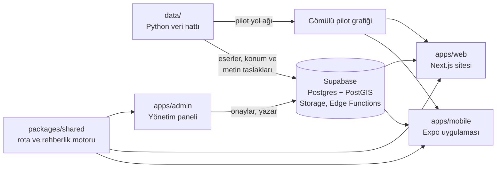

# Sezi

**Vakıf eserlerine yön tarif eden, çok duyulu ve erişilebilir keşif uygulamasıdır.**

Sezi, "100 metre sonra sağa dönün" yerine "Sebilin su sesini duyunca meydanın sağına yönelin" der. Yön tarifini koordinatlara değil, Kevin Lynch'in bilişsel haritalama yaklaşımına (yer işareti, düğüm, yol, bölge) dayandırır. Yer işaretlerini ortam sesleriyle, titreşimle ve sesli anlatımla birleştirir. Rota, kullanıcının görme, hareket ve işitme profiline göre hesaplanır: tekerlekli sandalye kullanan biri basamaklı yoldan geçmez, görme engelli biri gürültülü sokaktan uzak tutulur.

Proje, **42 Türkiye x Vakıf Katılım KÖK&KOD Hackathon** için LAHMACUN takımı tarafından geliştirildi.

- **Web sitesi:** [sezi.info](https://sezi.info)
- **Android uygulaması:** [Releases](../../releases) sayfasındaki en son `mobil-*` sürümünün APK dosyası

## Kapsam

- **Eser verisi:** Hatay, Konya ve Bursa'daki vakıf eserleri. Kaynak, Vakıf Katılım'ın vakıf eserleri envanter kitapları.
- **Sesli rehberlik ve rota (pilot alan):** Bursa, Ulu Cami ve Hanlar Bölgesi. Bu bölgenin yol ağı uygulamaya gömülüdür, rehberlik internetsiz de çalışır.
- **Dil:** Arayüz Türkçe ve İngilizce.

## Özellikler

**Mobil uygulama (Android)**
- **Algısal profil:** İlk açılışta görme, hareket ve işitme durumu sorulur. Rota, yönlendirme dili ve arayüz buna göre ayarlanır. Az gören kullanıcı için yüksek kontrast, büyük yazı, renk körlüğüne uygun renkler ve azaltılmış hareket seçenekleri vardır.
- **Profil ağırlıklı rota:** Basamak, eğim, zemin, kaldırım, yol genişliği, gürültü ve yer işaretinin görünürlüğü, Dijkstra tabanlı planlayıcıda profile göre ağırlıklandırılır.
- **Lynch tipi yönlendirme:** Talimatlar yer işaretleri ve kavşaklar üzerinden kurulur. Yer işaretinin sesi kulaklıkta geldiği yöne göre çalınır, dönüşler titreşimle de bildirilir.
- **İşitme engelliler için eşdeğerlik:** Her ses ipucunun görsel ve dokunsal (haptik) bir karşılığı vardır.
- **Simülasyon modu:** Rota, sahaya gitmeden sanal bir yürüyüşçüyle denenebilir.
- **Eser sayfası:** Fotoğraf, kaynaklı tarihçe, ziyaret bilgisi ve sesli dinleme. Her bilgi, envanter kitabının cilt ve sayfasına bağlanır.
- **Turlar, ziyaret pasaportu, başarılar, topluluk fotoğrafları ve erişilebilirlik bildirimleri.**
- **Sezi'ye Sor:** Eserler hakkında yalnızca doğrulanmış içerikten yanıt üreten soru-cevap.

**Web sitesi** ([sezi.info](https://sezi.info)): Eser, il, külliye, tur ve sergi sayfaları; rota planlama; hesap ve bildirim.

**Yönetim paneli:** İçerik onayı, eser metinlerinin kitapla karşılaştırılarak yayımlanması, konum eşleştirme, fotoğraf arşivi, rota noktaları, telefonsuz rota testi, bildirim moderasyonu ve kullanıcı yönetimi.

## Mimari



| Klasör | İçerik | Teknoloji |
|---|---|---|
| `apps/mobile` | Kullanıcı uygulaması | Expo SDK 57, React Native 0.86 (New Architecture), Expo Router, Mapbox |
| `apps/web` | Herkese açık web sitesi | Next.js 16, Tailwind CSS |
| `apps/admin` | Yönetim paneli | Vite, React 19, shadcn/ui, Mapbox GL |
| `packages/shared` | Rota planlayıcı, yönlendirme cümleleri, rota takibi, şemalar, tema | TypeScript, zod, Vitest |
| `supabase` | Şema (migration), RLS politikaları, seed verisi, Edge Functions (`ask`, `tts`, `summarize`, `admin-users`, `delete-account`) | Postgres, PostGIS, pgvector, Deno |
| `data` | Envanter kitaplarından ve OpenStreetMap'ten veri çıkaran betikler | Python |
| `docs` | Ürün, tasarım, mimari ve veri belgeleri | |

Sistemin ayrıntılı anlatımı: [docs/NASIL-CALISIR.md](docs/NASIL-CALISIR.md) ve [docs/MIMARI.md](docs/MIMARI.md).

## Hızlı başlangıç

Gerekenler: Node.js 22, pnpm 10. Mobil uygulama için ayrıca Android Studio ve JDK 17.

```bash
git clone https://github.com/kokkodhackathon/Sezi.git sezi
cd sezi
corepack enable
pnpm install

pnpm test         # ortak motorun testleri
pnpm typecheck    # tüm paketler

pnpm dev:web      # web sitesi → http://localhost:3001
pnpm dev:admin    # yönetim paneli → http://localhost:3000
```

Uygulamalar bir Supabase projesine ve Mapbox anahtarına ihtiyaç duyar. Ortam değişkenleri, kendi Supabase projenizi kurmak ve Android derlemesi için adım adım rehber: **[KURULUM.md](KURULUM.md)**.

## Erişilebilirlik ilkeleri

- Her akış ekrana bakmadan ve ekran okuyucuyla (TalkBack) tamamlanabilir.
- Her etkileşimli öğenin rolü ve etiketi vardır; dokunma alanları en az 48 dp'dir.
- Renk tek başına anlam taşımaz. Tema renklerinin WCAG AA kontrastı ve renk körlüğünde ayırt edilebilirliği testlerle korunur.
- Sistemin "hareketi azalt" tercihine uyulur.

## Veri ve telif

- **Envanter verisi** (eser adları, il, ilçe, tür, kitap cilt ve sayfası) Vakıf Katılım'ın vakıf eserleri envanter kitaplarından alınmıştır. Kitaplar hackathon kapsamında organizasyon tarafından veri seti olarak paylaşılmıştır. Bu veri MIT lisansının kapsamı dışındadır.
- **Kitap metinleri** (tarihçe, adres) depoda yer almaz. Yerel PDF'lerden taslak olarak üretilir ve yayımlanmadan önce kitap sayfasıyla elle karşılaştırılır. Yayımlanan her metin kitaba atıf verir.
- **Konumlar** Wikidata (CC0) ve OpenStreetMap (ODbL) kaynaklıdır. **Wikimedia Commons fotoğrafları** yazar ve lisans bilgisiyle gösterilir.
- Doğrulanmamış içerik kullanıcıya gösterilmez. Veritabanı düzeyinde (RLS) anonim kullanıcı yalnızca `verified` durumundaki içeriği okur.

Ayrıntılı veri politikası: [docs/ENVANTER.md](docs/ENVANTER.md).

## Belgeler

| Belge | İçerik |
|---|---|
| [KURULUM.md](KURULUM.md) | Geliştirme ortamı, ortam değişkenleri, Supabase, Android derlemesi, yayına alma |
| [docs/NASIL-CALISIR.md](docs/NASIL-CALISIR.md) | Sistemin şemalarla anlatımı: veri, rota, rehberlik, ses |
| [docs/MIMARI.md](docs/MIMARI.md) | Bileşenler, veri modeli, rota motoru |
| [docs/URUN.md](docs/URUN.md) | Kullanıcılar, ürün ilkeleri |
| [docs/TASARIM.md](docs/TASARIM.md) | Tasarım dili, tema, tipografi, bileşenler |
| [docs/ENVANTER.md](docs/ENVANTER.md) | Envanter kitapları ve veri politikası |
| [docs/ROADMAP.md](docs/ROADMAP.md) | Hackathon süresince iş planı ve durum |
| [data/README.md](data/README.md) | Veri hattı ve pilot grafiğinin üretimi |

## Takım

LAHMACUN takımı: Ediz (backend), Eda (frontend), İnci (tasarım), Zehra (veri).

## Lisans

Kaynak kod [MIT lisansı](LICENSE) ile yayımlanmıştır. Envanter verisi lisans kapsamı dışındadır (bkz. [Veri ve telif](#veri-ve-telif)).
